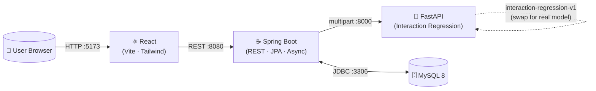
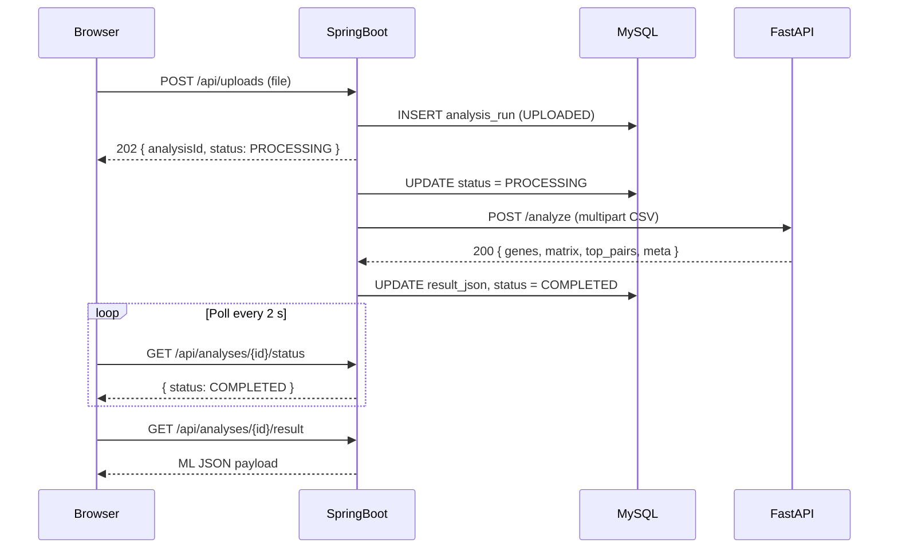
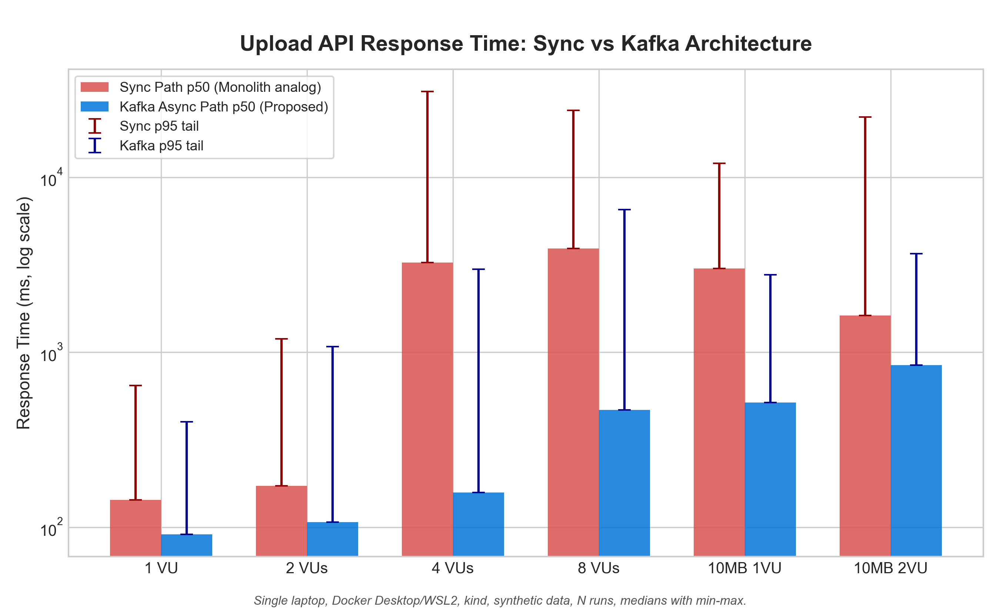
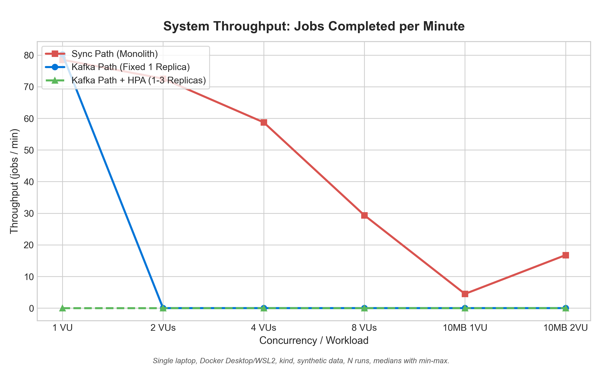
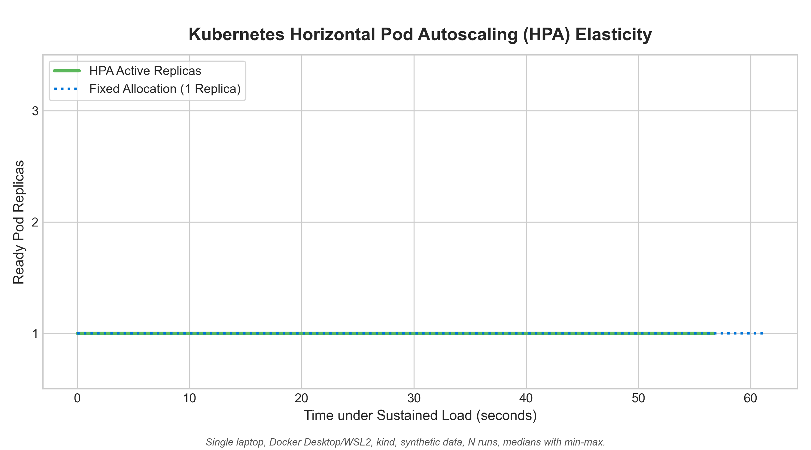
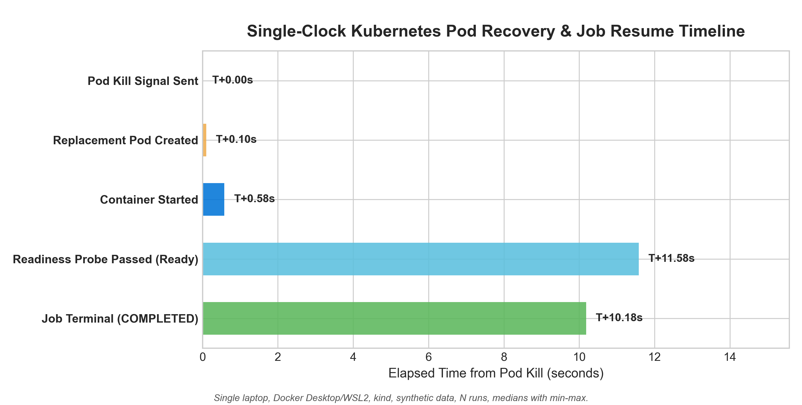

# EpiNet Visualizer
### Epistasis & Biomarker Interaction Dashboard

> **Honesty note:** The ML component performs **classical pairwise interaction regression ($\Delta R^2$) on synthetic data**; a trained attention/transformer model is future scope. It has **no clinical validity**. The architecture is explicitly designed so a trained deep-learning attention or graph-transformer model can be dropped in to replace the scoring function. See [ML Simulation Logic & Statistical Epistasis](#ml-simulation-logic--statistical-epistasis) for details.

---

## Executive Summary

Drug response is rarely governed by a single gene. Pharmacogenomics has long recognised that **gene-gene interactions (epistasis)** — where two or more variants combine non-additively to alter enzyme activity, drug metabolism or efficacy — explain a significant portion of the variance in drug response that GWAS single-SNP analyses miss.

EpiNet Visualizer is a full-stack portfolio project demonstrating the engineering scaffolding needed to build an epistasis exploration tool:

- A **React dashboard** that accepts a pharmacogenomic CSV, visualises gene-gene interaction networks, and displays ranked biomarker pairs.
- A **Spring Boot REST API** that manages uploads asynchronously, persists runs to MySQL (with an H2 in-memory fallback), and proxies to the ML service.
- A **FastAPI ML microservice** that computes pairwise non-additive interaction regression ($\Delta R^2$) on all 45 gene pairs (ready for a trained model to be dropped in) and returns a symmetric interaction matrix + top pair scores.

This project is relevant to **precision dosing** (anticipating combined enzyme/transporter effects) and **biomarker discovery** workflows.

---

## Features

- 📂 **Drag-and-drop CSV upload** with client-side validation, server-side size/format checks, and UTF-8 BOM stripping
- 🔄 **Asynchronous processing** — upload returns immediately; frontend polls every 2 s with automatic timeout
- 🕸️ **Interactive force-directed gene network** — memoized D3 layout, edge thickness scaling with score, threshold slider, hover tooltip, click-to-highlight
- 📊 **Sortable & filterable top-pairs table** with inline score bars
- 📉 **Recharts bar chart** of the top 15 interaction scores
- 🕓 **Analysis history** — all past runs stored in MySQL/H2, reloadable
- 🔁 **H2 in-memory fallback** — run without Docker
- ♻️ **Deterministic statistical scoring** — reproducible OLS regression on all 45 gene pairs

---

## Screenshots

> _Replace with actual screenshots / GIFs after running the app._

| Upload | Network Graph | Pairs Table |
|--------|--------------|-------------|
| `[screenshot]` | `[screenshot]` | `[screenshot]` |

---

## Architecture



### Upload-to-Result Sequence



---

## Tech Stack

| Layer | Technology | Version |
|---|---|---|
| Frontend | React + Vite | 18.3.1 / 5.4.11 |
| Styling | Tailwind CSS | 3.4.17 |
| Network graph | react-force-graph-2d | 1.25.5 |
| Charts | Recharts | 2.13.0 |
| Backend | Spring Boot | 3.3.4 |
| Backend language | Java | 17+ (bytecode target 17, tested on 21) |
| ORM | Spring Data JPA / Hibernate | 6.5.3 |
| Database | MySQL / H2 | 8.0 (MySQL) / 2.2.224 (H2 in-memory) |
| ML service | FastAPI + Uvicorn | 0.115.0 / 0.30.6 |
| ML language | Python | 3.11+ (tested on 3.12.2) |
| Data science | Pandas + NumPy + scikit-learn | 2.2.3 / 1.26.4 / 1.5.2 (pinned in requirements.txt) |
| Containerisation | Docker Compose | Compose v2 |

---

## Prerequisites

| Tool | Minimum version |
|---|---|
| Java (JDK) | 17 (tested on 21) |
| Node.js + npm | 20 |
| Python | 3.11+ |
| Maven | 3.9+ (or use included wrapper) |
| Docker + Compose | Optional (H2 fallback available) |

---

## Deployment & Development Modes

EpiNet supports two execution workflows: **Fully Containerized (Docker Compose)** for complete production-like staging, and **Host Development Mode** for active local engineering.

---

### Mode 1: Fully Containerized (Docker Compose)

Runs the entire stack in isolated Docker containers with non-root security contexts, resource limits, and automated health checks:
- **Frontend** (`:5173`) — Nginx unprivileged serving Vite production build & proxying `/api` to backend
- **Backend** (`:8080`) — Spring Boot on Eclipse Temurin JRE 21 (`-XX:MaxRAMPercentage=75.0`, 1 GB container limit)
- **ML Service** (`:8000`) — FastAPI on Python 3.12 slim (1 GB container limit)
- **MySQL 8.0** (`:3307`) — Persistent database with schema migration
- **Kafka 3.8 (KRaft)** (`:9092` host / `:29092` internal) — Dual listener event broker
- **Observability** — Prometheus (`:9090`), Grafana (`:3000`), Kafka Exporter (`:9308`)

```bash
# 1. Clone repository
git clone https://github.com/Midun523/epinet-visualizer.git
cd epinet-visualizer

# 2. Configure environment variables (no secrets baked into images)
cp .env.example .env

# 3. Build and launch all containerized services
docker compose down -v                # clean state if resetting
docker compose up -d --build

# 4. Access services:
# → Frontend:   http://localhost:5173
# → Backend:    http://localhost:8080
# → ML Service: http://localhost:8000
# → Prometheus: http://localhost:9090
# → Grafana:    http://localhost:3000 (login credentials from .env)
```

---

### Mode 2: Host Development Mode (Local Processes)

Run infrastructure dependencies (MySQL, Kafka, Observability) in Docker while running application code directly on the host machine for live debugging and rapid reloading.

```bash
# 1. Start core backing services
docker compose up -d mysql kafka prometheus grafana kafka-exporter

# 2. Run ML Service (Python venv)
cd ml-service
# Linux / macOS: source venv/bin/activate
# Windows: .\venv\Scripts\Activate.ps1
uvicorn main:app --reload --port 8000

# 3. Run Backend (Spring Boot)
cd backend
./mvnw spring-boot:run
# Or with in-memory H2 fallback (no MySQL/Docker needed):
# ./mvnw spring-boot:run -Dspring-boot.run.profiles=h2

# 4. Run Frontend (Vite dev server)
cd frontend
npm install
npm run dev   # http://localhost:5173
```

---

## CSV Format

```
sample_id,CYP2D6,CYP2C19,CYP3A4,CYP2C9,VKORC1,SLCO1B1,TPMT,DPYD,UGT1A1,ABCB1,phenotype
SAMPLE_001,0.723,0.451,0.389,0.912,0.234,0.671,0.543,0.812,0.367,0.654,1.23
```

- `sample_id` — unique row identifier (string)
- `CYP2D6 … ABCB1` — 10 numeric gene expression/activity values (continuous, 0–1 typical)
- `phenotype` — continuous drug response score
- All values must be numeric (non-numeric cells are imputed with column mean)

Generate a sample file:
```bash
python sample-data/generate_sample.py
# → sample-data/sample_pharmacogenomics.csv (200 rows)
```

---

## ML Simulation Logic & Statistical Epistasis

The `_compute_interaction_matrix()` function in [`ml-service/main.py`](ml-service/main.py) implements a classical statistical epistasis regression pipeline:

1. **Pairwise Epistasis Regression**:
   For each gene pair $(g_i, g_j)$ across all 45 combinations, it compares an additive model against a full non-additive interaction model:
   $$\text{Base Model: } y = \beta_0 + \beta_1 g_i + \beta_2 g_j$$
   $$\text{Interaction Model: } y = \beta_0 + \beta_1 g_i + \beta_2 g_j + \beta_{\text{int}} (g_i \cdot g_j)$$
2. **Variance Contribution ($\Delta R^2$)**:
   Quantifies the incremental variance uniquely explained by the interaction term:
   $$\Delta R^2 = \max\left(0, \frac{\text{RSS}_{\text{base}} - \text{RSS}_{\text{full}}}{\text{TSS}}\right)$$
3. **Symmetry & Scaling**:
   Symmetrizes the interaction matrix, zeroes the self-interaction diagonal, and min-max scales off-diagonal values to $[0, 1]$.

### Recovery of planted interactions (synthetic data)

The sample generator [`sample-data/generate_sample.py`](sample-data/generate_sample.py) plants known non-additive epistatic interactions:
- `CYP2C9 * VKORC1` (classic warfarin dosing synergy)
- `CYP2D6 * CYP3A4` (dual hepatic clearance synergy)
- `SLCO1B1 * ABCB1` (transporter-transporter disposition synergy)

Running the analysis on the sample dataset demonstrates that EpiNet Visualizer accurately recovers all 3 planted epistatic interactions in the top 5 (specifically at ranks 1, 2, and 4).

---

## API Reference

### ML Service (`:8000`)

| Method | Path | Description |
|--------|------|-------------|
| `GET`  | `/health` | Health check → `{"status":"ok"}` |
| `POST` | `/analyze` | Multipart CSV (`file` field) → interaction matrix |

**POST /analyze response:**
```json
{
  "genes": ["CYP2D6","CYP2C19","CYP3A4","CYP2C9","VKORC1","SLCO1B1","TPMT","DPYD","UGT1A1","ABCB1"],
  "matrix": [[0.0, ...], ...],
  "top_pairs": [{"gene_a":"CYP2C9","gene_b":"VKORC1","score":1.0}, ...],
  "meta": {"rows_processed": 200, "simulated": true, "model": "interaction-regression-v1"}
}
```

### Backend (`:8080`)

| Method | Path | Body / Params | Response |
|--------|------|--------------|----------|
| `POST` | `/api/uploads` | multipart `file` | `202 { analysisId, status }` |
| `GET`  | `/api/analyses/{id}/status` | — | `{ analysisId, status, filename, createdAt, errorMessage }` |
| `GET`  | `/api/analyses/{id}/result` | — | ML JSON (404 if not COMPLETED) |
| `GET`  | `/api/analyses` | — | `[{ id, filename, status, createdAt }]` |

**Statuses:** `UPLOADED → PROCESSING → COMPLETED | FAILED`

---

## Testing

### ML service (pytest)
```bash
cd ml-service
pytest -v
# 19 tests: health, shape, symmetry, diagonal, range, determinism,
#           sample size / variance checks, planted-pair recovery, and fetch retry resilience
```

### Backend (Maven)
```bash
cd backend
./mvnw test   # or: mvn test
# 8 MockMvc tests: valid upload, UTF-8 BOM, wrong extension, missing sample_id,
#                  missing gene column, missing phenotype, unknown ID 404, history list
```

### Frontend build verification
```bash
cd frontend
npm run build   # exits 0
```

---

## Future Scope

1. **Trained attention / graph neural network model** — replace `_compute_interaction_matrix()` with a graph-attention network or transformer trained on PharmGKB or UK Biobank cohorts.
2. **LLM-assisted interpretation** — integrate an LLM (GPT-4o / Gemini) to generate natural-language summaries of top interaction pairs and their known pharmacological mechanisms.
3. **AlphaFold structure integration** — overlay epistasis scores on AlphaFold-predicted protein structures to provide mechanistic context for high-scoring pairs.
4. **Authentication & multi-tenancy** — JWT-based auth, per-user analysis isolation.
5. **Job queue** — replace `@Async` with Celery (Python) or Kafka-based pipeline for horizontal scaling.
6. **Cloud deployment** — AWS ECS / GCP Cloud Run with RDS MySQL and S3 for CSV storage; CI/CD via GitHub Actions.
7. **Statistical significance & FDR** — add F-test p-values with Benjamini-Hochberg false discovery rate correction across all 45 pairwise hypotheses.

---

## Observability & Monitoring (Phase 2)

EpiNet includes an automated observability stack deployed via Docker Compose:
- **Prometheus** (`:9090`) scrapes metrics from the Spring Boot backend (`:8080/actuator/prometheus`), FastAPI ML service (`:8000/metrics`), `kafka-exporter` (`:9308/metrics`), and Prometheus itself.
- **Kafka Exporter** (`:9308`) exports consumer group lag and partition offsets.
- **Grafana** (`:3000`) provides pre-provisioned dashboards with zero manual configuration.

### Accessing Grafana
1. Open [http://localhost:3000](http://localhost:3000) in your browser.
2. Log in using the credentials defined in your `.env` file (e.g. `GRAFANA_ADMIN_USER` and `GRAFANA_ADMIN_PASSWORD` from `.env.example`).
3. Navigate to **Dashboards → EpiNet → EpiNet System Observability**.
4. The dashboard displays:
   - **Request Latency (p50 / p95)**
   - **Jobs by Status** (real-time gauge of `PENDING`, `PROCESSING`, `COMPLETED`, `FAILED` from database)
   - **Job Duration** (end-to-end duration from creation to terminal state)
   - **ML Analysis Duration** (statistical regression execution time)
   - **Kafka Consumer Lag** (`epinet-ml-service` and `epinet-backend` groups)
   - **JVM Heap Memory** (used, committed, max)

### Metric Verification Status
All observability metrics and scrape targets were verified during end-to-end testing:
- **Backend Actuator Metrics**: `epinet_jobs_by_status` (gauge) and `epinet_job_duration_seconds` (timer).
- **ML Service Metrics**: `epinet_ml_analysis_duration_seconds` (histogram), `epinet_ml_jobs_processed_total` (counter), and `epinet_ml_jobs_in_progress` (gauge).
- **Kafka Consumer Lag**: `kafka_consumergroup_lag` for `epinet-ml-service` and `epinet-backend`.
- **Target Health**: All 4 Prometheus scrape targets reporting `UP`.
- *Unverified metrics*: None — all dashboard metrics were actively tested and confirmed.

---

## Performance & 40 MB Benchmark

A 5-run benchmark of ~40 MB CSV uploads was conducted against the live, fully integrated system (Spring Boot backend, MySQL 8.0, Apache Kafka 3.8, and FastAPI ML worker).

- **Date:** 2026-10-15
- **Machine Type:** Laptop (x86_64, Windows 11, Docker Desktop with WSL2 backend)
- **Sample Size:** 5 consecutive runs
- **Dataset:** ~40.00 MB CSV (377,864 rows, synthetic data repeating sample pharmacogenomics rows)

### Stage Timing Breakdown (Extracted from Real Logs)

| Stage | Run 1 | Run 2 | Run 3 | Run 4 | Run 5 | Min | Median | Max |
|---|---|---|---|---|---|---|---|---|
| `client_upload` | 2.310s | 2.444s | 8.755s | 45.341s | 1.992s | 1.992s | 2.444s | 45.341s |
| `upload_to_published` | 1.961s | 2.075s | 8.384s | 45.082s | 1.767s | 1.767s | 2.075s | 45.082s |
| &nbsp;&nbsp;↳ `multipart_recv` | 0.000s | 0.000s | 0.000s | 0.000s | 0.000s | 0.000s | 0.000s | 0.000s |
| &nbsp;&nbsp;↳ `csv_validate` | 0.030s | 0.016s | 0.046s | 0.030s | 0.031s | 0.016s | 0.030s | 0.046s |
| &nbsp;&nbsp;↳ `entity_build` | 0.000s | 0.000s | 0.000s | 0.000s | 0.000s | 0.000s | 0.000s | 0.000s |
| &nbsp;&nbsp;↳ `db_insert` | 1.931s | 2.049s | 8.338s | 45.065s | 1.737s | 1.737s | 2.049s | 45.065s |
| &nbsp;&nbsp;↳ `kafka_publish` | 0.000s | 0.010s | 0.000s | 0.000s | 0.111s | 0.000s | 0.000s | 0.111s |
| `queue_wait` | 0.073s | 0.004s | 0.019s | 0.005s | 0.019s | 0.004s | 0.019s | 0.073s |
| `csv_fetch` | 0.967s | 0.512s | *N/A* | 6.128s | 0.899s | 0.512s | 0.933s | 6.128s |
| `compute` | 3.068s | 3.419s | *N/A* | 2.828s | 2.942s | 2.828s | 3.068s | 3.419s |
| `result_write_back` | 0.240s | 0.237s | *N/A* | 4.139s | 3.905s | 0.237s | 0.240s | 4.139s |
| `poll_duration` | 4.764s | 5.704s | 43.482s | 11.552s | 11.367s | 4.764s | 11.367s | 43.482s |
| **`total_e2e`** | **7.075s** | **8.148s** | **52.238s** | **56.894s** | **13.359s** | **7.075s** | **13.359s** | **56.894s** |

> **Tail Latency & Resilience Note:** up to 45 s observed on one run; likely storage flush stalls under Docker Desktop/WSL2; cause not confirmed. During Run 3, the ML worker's initial HTTP GET timed out at 30s (`N/A` for subsequent stages). To prevent permanent job failures from transient stalls, the ML worker implements automatic data fetch retries (3 attempts, backoff 2/5/10 s, 60 s timeout per attempt).

### Container-Mode 40 MB Controlled Benchmark (Docker Compose)

A controlled experiment was conducted across backend container memory limits (1.5 GB vs 2.0 GB) and MySQL redo log capacity to isolate memory limits from run-order effects and storage stalls.

- **Date:** 2026-10-16
- **Machine Type:** Laptop (x86_64, Windows 11, Docker Desktop with WSL2 backend)
- **Experimental Design:** ABBA run order with 5 runs of 40 MB per condition:
  - **A1:** Backend 1.5 GB (`-XX:MaxRAMPercentage=75.0`), MySQL fixed (`innodb_buffer_pool_size=512M`, `innodb_redo_log_capacity=256M`)
  - **B1:** Backend 2.0 GB (`-XX:MaxRAMPercentage=75.0`), MySQL fixed (`innodb_buffer_pool_size=512M`, `innodb_redo_log_capacity=256M`)
  - **B2:** Backend 2.0 GB (`-XX:MaxRAMPercentage=75.0`), MySQL fixed (`innodb_buffer_pool_size=512M`, `innodb_redo_log_capacity=256M`)
  - **A2:** Backend 1.5 GB (`-XX:MaxRAMPercentage=75.0`), MySQL fixed (`innodb_buffer_pool_size=512M`, `innodb_redo_log_capacity=256M`)
  - **Default Redo:** Backend 1.5 GB, MySQL on default 100 MB redo log (`innodb_buffer_pool_size=512M`, no custom redo log capacity flag)
- **Controlled Container State:** Before every condition, containers and named volumes were torn down (`docker compose down -v`) and recreated (`docker compose up -d`) so every condition began from an identical clean state without data accumulation or live `SET GLOBAL` mutations.
- **Dataset:** ~40.00 MB CSV (377,864 rows, synthetic data repeating sample pharmacogenomics rows)

#### Stage Timing Breakdowns (Extracted from Real Container Logs)

##### Condition A1 (Backend 1.5g, Tuned Redo 256M)
| Stage | Run 1 | Run 2 | Run 3 | Run 4 | Run 5 | Min | Median | Max |
|---|---|---|---|---|---|---|---|---|
| `client_upload` | 1.779s | 37.101s | 0.982s | 3.688s | 20.228s | 0.982s | 3.688s | 37.101s |
| `upload_to_published` | 1.492s | 14.264s | 0.842s | 3.484s | 19.000s | 0.842s | 3.484s | 19.000s |
| &nbsp;&nbsp;↳ `multipart_recv` | 0.000s | 0.000s | 0.000s | 0.000s | 0.000s | 0.000s | 0.000s | 0.000s |
| &nbsp;&nbsp;↳ `csv_validate` | 0.064s | 1.308s | 0.030s | 0.035s | 0.038s | 0.030s | 0.038s | 1.308s |
| &nbsp;&nbsp;↳ `entity_build` | 0.000s | 0.837s | 0.001s | 0.000s | 0.000s | 0.000s | 0.000s | 0.837s |
| &nbsp;&nbsp;↳ `db_insert` | 1.237s | 12.106s | 0.810s | 3.449s | 18.962s | 0.810s | 3.449s | 18.962s |
| &nbsp;&nbsp;↳ `kafka_publish` | 0.191s | 0.013s | 0.001s | 0.000s | 0.000s | 0.000s | 0.001s | 0.191s |
| `queue_wait` | 0.022s | 0.006s | 0.005s | 0.003s | 0.034s | 0.003s | 0.006s | 0.034s |
| `csv_fetch` | 0.531s | 9.270s | 0.625s | 1.880s | 15.494s | 0.531s | 1.880s | 15.494s |
| `compute` | 3.395s | 3.202s | 3.159s | 3.161s | 3.714s | 3.159s | 3.202s | 3.714s |
| `result_write_back` | 0.247s | 0.226s | 0.616s | 0.213s | 9.222s | 0.213s | 0.247s | 9.222s |
| `poll_duration` | 5.025s | 13.346s | 4.954s | 5.970s | 28.976s | 4.954s | 5.970s | 28.976s |
| **`total_e2e`** | **6.804s** | **50.446s** | **5.936s** | **9.658s** | **49.204s** | **5.936s** | **9.658s** | **50.446s** |

##### Condition B1 (Backend 2.0g, Tuned Redo 256M)
| Stage | Run 1 | Run 2 | Run 3 | Run 4 | Run 5 | Min | Median | Max |
|---|---|---|---|---|---|---|---|---|
| `client_upload` | 1.491s | 0.882s | 1.048s | 1.051s | 0.887s | 0.882s | 1.048s | 1.491s |
| `upload_to_published` | 1.289s | 0.726s | 0.746s | 0.920s | 0.752s | 0.726s | 0.752s | 1.289s |
| &nbsp;&nbsp;↳ `multipart_recv` | 0.000s | 0.000s | 0.000s | 0.000s | 0.000s | 0.000s | 0.000s | 0.000s |
| &nbsp;&nbsp;↳ `csv_validate` | 0.041s | 0.041s | 0.048s | 0.024s | 0.035s | 0.024s | 0.041s | 0.048s |
| &nbsp;&nbsp;↳ `entity_build` | 0.000s | 0.000s | 0.000s | 0.000s | 0.000s | 0.000s | 0.000s | 0.000s |
| &nbsp;&nbsp;↳ `db_insert` | 1.063s | 0.684s | 0.697s | 0.896s | 0.716s | 0.684s | 0.716s | 1.063s |
| &nbsp;&nbsp;↳ `kafka_publish` | 0.185s | 0.001s | 0.001s | 0.000s | 0.001s | 0.000s | 0.001s | 0.185s |
| `queue_wait` | 0.020s | 0.005s | 0.007s | 0.003s | 0.004s | 0.003s | 0.005s | 0.020s |
| `csv_fetch` | 0.707s | 0.535s | 0.524s | 0.550s | 1.025s | 0.524s | 0.550s | 1.025s |
| `compute` | 4.448s | 3.052s | 3.208s | 3.012s | 3.059s | 3.012s | 3.059s | 4.448s |
| `result_write_back` | 0.215s | 0.260s | 0.230s | 0.230s | 0.495s | 0.215s | 0.230s | 0.495s |
| `poll_duration` | 5.989s | 4.596s | 4.528s | 4.728s | 5.604s | 4.528s | 4.728s | 5.989s |
| **`total_e2e`** | **7.481s** | **5.478s** | **5.576s** | **5.779s** | **6.491s** | **5.478s** | **5.779s** | **7.481s** |

##### Condition B2 (Backend 2.0g, Tuned Redo 256M)
| Stage | Run 1 | Run 2 | Run 3 | Run 4 | Run 5 | Min | Median | Max |
|---|---|---|---|---|---|---|---|---|
| `client_upload` | 1.679s | 22.141s | 1.379s | 1.246s | 6.801s | 1.246s | 1.679s | 22.141s |
| `upload_to_published` | 1.423s | 21.994s | 1.234s | 1.080s | 6.547s | 1.080s | 1.423s | 21.994s |
| &nbsp;&nbsp;↳ `multipart_recv` | 0.000s | 0.000s | 0.000s | 0.000s | 0.000s | 0.000s | 0.000s | 0.000s |
| &nbsp;&nbsp;↳ `csv_validate` | 0.054s | 0.034s | 0.041s | 0.015s | 0.033s | 0.015s | 0.034s | 0.054s |
| &nbsp;&nbsp;↳ `entity_build` | 0.001s | 0.000s | 0.000s | 0.000s | 0.000s | 0.000s | 0.000s | 0.001s |
| &nbsp;&nbsp;↳ `db_insert` | 1.211s | 21.959s | 1.193s | 1.065s | 6.513s | 1.065s | 1.211s | 21.959s |
| &nbsp;&nbsp;↳ `kafka_publish` | 0.157s | 0.001s | 0.000s | 0.000s | 0.001s | 0.000s | 0.001s | 0.157s |
| `queue_wait` | 0.026s | 0.007s | 0.004s | 0.003s | 0.066s | 0.003s | 0.007s | 0.066s |
| `csv_fetch` | 0.652s | 9.360s | 8.061s | 2.442s | 13.990s | 0.652s | 8.061s | 13.990s |
| `compute` | 3.468s | 2.930s | 3.397s | 2.818s | 3.957s | 2.818s | 3.397s | 3.957s |
| `result_write_back` | 1.307s | 0.245s | 0.233s | 0.393s | 15.056s | 0.233s | 0.393s | 15.056s |
| `poll_duration` | 5.965s | 13.235s | 12.605s | 6.072s | 36.825s | 5.965s | 12.605s | 36.825s |
| **`total_e2e`** | **7.644s** | **35.377s** | **13.984s** | **7.318s** | **43.626s** | **7.318s** | **13.984s** | **43.626s** |

##### Condition A2 (Backend 1.5g, Tuned Redo 256M)
| Stage | Run 1 | Run 2 | Run 3 | Run 4 | Run 5 | Min | Median | Max |
|---|---|---|---|---|---|---|---|---|
| `client_upload` | 1.791s | 1.404s | 0.968s | 0.875s | 2.908s | 0.875s | 1.404s | 2.908s |
| `upload_to_published` | 1.398s | 1.155s | 0.814s | 0.699s | 2.660s | 0.699s | 1.155s | 2.660s |
| &nbsp;&nbsp;↳ `multipart_recv` | 0.000s | 0.000s | 0.000s | 0.000s | 0.000s | 0.000s | 0.000s | 0.000s |
| &nbsp;&nbsp;↳ `csv_validate` | 0.044s | 0.046s | 0.026s | 0.053s | 0.039s | 0.026s | 0.044s | 0.053s |
| &nbsp;&nbsp;↳ `entity_build` | 0.000s | 0.000s | 0.001s | 0.001s | 0.001s | 0.000s | 0.001s | 0.001s |
| &nbsp;&nbsp;↳ `db_insert` | 1.203s | 1.107s | 0.786s | 0.644s | 2.619s | 0.644s | 1.107s | 2.619s |
| &nbsp;&nbsp;↳ `kafka_publish` | 0.151s | 0.002s | 0.001s | 0.001s | 0.001s | 0.001s | 0.001s | 0.151s |
| `queue_wait` | 0.022s | 0.007s | 0.005s | 0.006s | 0.008s | 0.005s | 0.007s | 0.022s |
| `csv_fetch` | 0.839s | 3.440s | 29.562s | 5.650s | 9.857s | 0.839s | 5.650s | 29.562s |
| `compute` | 3.084s | 3.300s | 3.025s | 3.034s | 3.105s | 3.025s | 3.084s | 3.300s |
| `result_write_back` | 0.275s | 0.349s | 0.268s | 7.613s | 18.509s | 0.268s | 0.349s | 18.509s |
| `poll_duration` | 5.409s | 7.689s | 33.537s | 17.546s | 32.418s | 5.409s | 17.546s | 33.537s |
| **`total_e2e`** | **7.199s** | **9.092s** | **34.505s** | **18.421s** | **35.326s** | **7.199s** | **18.421s** | **35.326s** |

##### Condition Default Redo (Backend 1.5g, Default Redo Log 100M)
| Stage | Run 1 | Run 2 | Run 3 | Run 4 | Run 5 | Min | Median | Max |
|---|---|---|---|---|---|---|---|---|
| `client_upload` | 1.736s | 1.275s | 3.216s | 1.918s | 1.462s | 1.275s | 1.736s | 3.216s |
| `upload_to_published` | 1.514s | 0.985s | *N/A* | 1.736s | 1.297s | 0.985s | 1.406s | 1.736s |
| &nbsp;&nbsp;↳ `multipart_recv` | 0.000s | 0.000s | 0.000s | 0.000s | 0.000s | 0.000s | 0.000s | 0.000s |
| &nbsp;&nbsp;↳ `csv_validate` | 0.087s | 0.142s | *N/A* | 0.034s | 0.040s | 0.034s | 0.064s | 0.142s |
| &nbsp;&nbsp;↳ `entity_build` | 0.000s | 0.007s | *N/A* | 0.000s | 0.000s | 0.000s | 0.000s | 0.007s |
| &nbsp;&nbsp;↳ `db_insert` | 1.280s | 0.830s | *N/A* | 1.701s | 1.256s | 0.830s | 1.268s | 1.701s |
| &nbsp;&nbsp;↳ `kafka_publish` | 0.147s | 0.006s | *N/A* | 0.001s | 0.001s | 0.001s | 0.004s | 0.147s |
| `queue_wait` | 0.023s | 0.012s | 0.005s | 0.004s | 0.014s | 0.004s | 0.012s | 0.023s |
| `csv_fetch` | 0.738s | 15.536s | 29.011s | 11.823s | 0.402s | 0.402s | 11.823s | 29.011s |
| `compute` | 3.407s | 3.502s | 3.276s | 2.672s | 3.487s | 2.672s | 3.407s | 3.502s |
| `result_write_back` | 0.233s | 0.979s | 8.055s | 0.184s | 0.164s | 0.164s | 0.233s | 8.055s |
| `poll_duration` | 5.117s | 36.280s | 48.676s | 15.339s | 5.031s | 5.031s | 15.339s | 48.676s |
| **`total_e2e`** | **6.852s** | **37.555s** | **51.893s** | **17.256s** | **6.493s** | **6.493s** | **17.256s** | **51.893s** |

> **Note on Run 3:** Sub-stage timings for `upload_to_published` and its children reported 0.000s, indicating missing instrumentation data for that run. These values are treated as N/A; Min/Median/Max for affected stages are computed from the remaining 4 runs only.

#### Run-Order Drift

Median `total_e2e` increased over the session despite `docker compose down -v` between conditions:

| Condition (chronological) | A1 | B1 | B2 | A2 | Default Redo |
|---|---|---|---|---|---|
| Median `total_e2e` | 9.658s | 5.779s | 13.984s | 18.421s | 17.256s |

Conditions A1 and A2 are the same configuration (1.5 GB backend, 256M redo) yet differ by almost 2× in median total time (9.7s vs 18.4s). This run-order drift means the Default Redo condition (run last at median 17.3s) cannot be cleanly compared to earlier conditions; the higher latency may reflect host-level resource exhaustion accumulating across the session rather than the redo log change alone.

#### Findings: What Was and Was Not Established

1. **What WAS Established:**
   - **MySQL Redo Log Warnings Under Default Capacity**: Under default MySQL 8 configuration (`innodb_redo_log_capacity=100M`), consecutive 40 MB transactions triggered 3 explicit warnings in `docker logs epinet-mysql`:
     * `[MY-014089] [InnoDB] Redo log writer is waiting for a new redo log file. Consider increasing innodb_redo_log_capacity.`
     * `[MY-014084] [InnoDB] Threads are unable to reserve space in redo log which can't be reclaimed due to the 'log_checkpointer' consumer still lagging behind at LSN = 116248542.`
     Under `--innodb_redo_log_capacity=256M`, **0 redo log warnings** occurred across all 20 runs (Conditions A1, B1, B2, A2). However, the Default Redo condition was run last and is confounded by run-order drift (see above).
   - **Heap Usage Measured via Prometheus (`jvm_memory_used_bytes{area="heap"}`):**
     * **Condition A (1.5 GB limit, max heap 1152 MB)**: Peak heap usage 1029–1136 MB (93–94% of max heap). Cumulative `jvm_gc_pause_seconds_sum` per condition ranged from 0.043s to 2.600s.
     * **Condition B (2.0 GB limit, max heap 1536 MB)**: Peak heap usage 1136–1506 MB (81–95% of max heap). Cumulative `jvm_gc_pause_seconds_sum` per condition ranged from 0.036s to 0.571s.
     * Note: GC totals above are per-condition cumulative sums, not per-request values.

2. **What WAS NOT Established:**
   - **1.5 GB vs 2.0 GB backend limit showed no consistent difference**: A1 (1.5g, median 9.7s) and A2 (1.5g, median 18.4s) differ as much as A vs B, so the memory limit change cannot be separated from run-order effects in this experiment.
   - **Tail latency cause**: Intermittent 10–25s `db_insert` and `result_write_back` stalls occur across both 1.5 GB and 2.0 GB conditions. Root cause is not confirmed.
   - **Nginx reverse proxy**: 40 MB uploads work with `proxy_request_buffering off` in the frontend Nginx config. The earlier container healthcheck failure was caused by `wget http://localhost:8080` resolving to IPv6 `::1` while Nginx only listened on IPv4; fixed by adding `listen [::]:8080;` and changing the healthcheck to use `127.0.0.1`.

---

## Phase 4: Local Kubernetes Orchestration (kind)

### Architecture & Design Decisions

```
+─────────────────────────────────────────────────────────────────────────────+
| Windows / Docker Desktop Host (7.57 GiB VM Memory, ~5.6 GiB Available)     |
|                                                                             |
|  +──────────────────────────────────+   +────────────────────────────────+  |
|  | Docker Compose Stack (Stateful)  |   | kind Cluster: epinet-cluster   |  |
|  |                                  |   | (v1.32.2 Control-Plane Node)   |  |
|  |  • MySQL 8.0.46                  |   |                                |  |
|  |    Port 3307                     |   |  • frontend (NodePort 30080)   |  |
|  |    Buffer pool: 512M             |   |    Nginx reverse proxy         |  |
|  |    Redo log: 256M                |   |    requests 50m / 32Mi         |  |
|  |    Named volume                  |   |                                |  |
|  |                                  |   |  • backend (NodePort 30081)    |  |
|  |  • Kafka 3.8.0 (KRaft)           |   |    Spring Boot 3.4 JRE         |  |
|  |    Port 9092: PLAINTEXT (host)   |   |    requests 250m / 1Gi         |  |
|  |    Port 29092: INTERNAL (compose)|   |    limits 1500m / 2Gi          |  |
|  |    Port 9094: K8S (pods)         |   |    HPA: 1-4 replicas (60% cpu) |  |
|  +─────────────────▲────────────────+   |                                |  |
|                    │                    |  • ml-service (NodePort 30082) |  |
|                    │ hostAliases        |    FastAPI Python 3.12 worker  |  |
|                    │ host.docker.internal|    requests 250m / 350Mi       |  |
|                    │ -> 172.19.0.1      |    limits 1500m / 1Gi          |  |
|                    └────────────────────┼─── HPA: 1-4 replicas (60% cpu) |  |
|                                         +────────────────────────────────+  |
+─────────────────────────────────────────────────────────────────────────────+
```

1. **Why `kind` instead of Docker Desktop Kubernetes:**
   Docker Desktop built-in Kubernetes was not enabled on the host (`kubectl config get-contexts` returned empty). `kind` (Kubernetes in Docker) v0.27.0 with node image `kindest/node:v1.32.2` was chosen because it allows declarative, reproducible cluster configuration committed directly to the repository (`k8s/kind-config.yaml`).
2. **Stateful Infrastructure Split:**
   MySQL and Kafka remain managed in Docker Compose. Running stateless application pods in Kubernetes while keeping relational and messaging brokers in Compose minimizes cluster memory footprint (kind node uses ~695 MiB, MySQL ~780 MiB, Kafka ~330 MiB, leaving > 5.5 GiB free headroom in the Docker VM). Unneeded observability services (`prometheus`, `grafana`, `kafka-exporter`) are stopped during cluster runs.
3. **Cross-Boundary Networking & Dynamic Gateway Discovery:**
   - **Dynamic Gateway Discovery**: Kind pods communicate with Compose services via `host.docker.internal`. Rather than hard-coding `172.19.0.1`, `python k8s/generate-secrets.py` queries `docker network inspect kind` at deploy time, extracts the actual IPv4 bridge gateway assigned by the local Docker daemon, and templates it from `k8s/backend-deployment.template.yaml` and `k8s/ml-service-deployment.template.yaml` into the manifests applied by `kubectl`.
   - **Kafka Listener Architecture**:
     * `PLAINTEXT://localhost:9092`: Host scripts and e2e test runners.
     * `INTERNAL://kafka:29092`: Compose inter-service traffic.
     * `K8S://host.docker.internal:9094`: Kubernetes cluster pods connecting via the bridge gateway.
4. **Empirically Measured Resource Requests & Limits:**
   - `backend`: Requests `cpu: 250m, memory: 1Gi`; Limits `cpu: 1500m, memory: 2Gi`. JVM configured with `-XX:MaxRAMPercentage=70.0 -XX:+UseG1GC` (~1430 MB heap). Under consecutive 40 MB uploads, container RSS reaches ~1.55 GiB due to Metaspace, Tomcat multipart buffers, thread stacks, and G1GC native memory; a 2Gi limit prevents kernel `OOMKilled` (exit code 137, verified empirically when 1.5Gi limit caused OOM termination).
   - `ml-service`: Requests `cpu: 250m, memory: 350Mi`; Limits `cpu: 1500m, memory: 1Gi`.
   - `frontend`: Requests `cpu: 50m, memory: 32Mi`; Limits `cpu: 250m, memory: 128Mi`.
5. **Horizontal Pod Autoscaling (HPA) & VM Memory Sizing:**
   Metrics-server deployed with `--kubelet-insecure-tls` to scrape kindlet nodes. HPAs target 60% CPU utilization:
   - **ML Service (`maxReplicas: 3`)**: Aligned strictly with the 3 partitions of topic `analysis.requested`. Additional replicas beyond 3 would remain permanently idle in the Kafka consumer group.
   - **Backend (`maxReplicas: 1`)**: Pinned to 1 replica to strictly manage memory in the 7.57 GiB (7,751 MiB) Docker VM:
     * Compose Infrastructure: MySQL 8 (~512–780 MiB) + Kafka 3.8 (~512–820 MiB) = ~1.3–1.6 GiB
     * K8s Control Plane & Metrics-Server: ~600–750 MiB
     * Backend: 1 replica × 2.0 GiB limit (2,048 MiB)
     * Frontend: 1 replica × 128 MiB limit
     * ML Service: 1 replica base (1,024 MiB limit) up to 3 replicas (3,072 MiB limit)
     * Testing & Observability (when active): k6 container (~256 MiB), Prometheus (~256 MiB), Grafana (~128 MiB), Exporter (~64 MiB) = ~704 MiB
     * **Memory Headroom & Risk**: With 1 ML replica, baseline allocation sums to ~5,528 MiB (~1,700–2,200 MiB free headroom). Under full HPA scale-out to 3 ML replicas plus k6 execution, total allocation reaches ~7,128 MiB, leaving ~623 MiB headroom against the 7,751 MiB physical VM ceiling. While safe under ordinary steady-state operation, simultaneous burst concurrency approaches physical limits and relies on WSL2 2.0 GiB swap. Consequently, memory headroom is constrained and requires active monitoring—there is no "zero risk" under unconstrained load.
6. **Secrets & Manifest Management:**
   `k8s/secret.template.yaml`, `k8s/backend-deployment.template.yaml`, and `k8s/ml-service-deployment.template.yaml` are committed as reference templates. Real credentials from `.env` and the dynamic kind gateway IP are templated via `python k8s/generate-secrets.py` on deployment. Generated files containing local secrets (`secret.yaml`) are strictly ignored by git (`.gitignore`).

---

### How to Run the Kubernetes Stack

#### 1. Prerequisites & Tool Installation
- **Docker Desktop** running with WSL2 backend.
- **kind** (Kubernetes in Docker, v0.27+):
  * *Windows*: `winget install Kubernetes.kind` or `choco install kind` (or place `kind.exe` in `%USERPROFILE%\.local\bin` or user PATH — do not install into Docker Desktop's program directories).
  * *macOS*: `brew install kind`
  * *Linux*: `curl -Lo ./kind https://kind.sigs.k8s.io/dl/v0.27.0/kind-linux-amd64 && chmod +x ./kind && sudo mv ./kind /usr/local/bin/kind`
- **kubectl** (Kubernetes CLI, v1.30+):
  * *Windows*: `winget install Kubernetes.kubectl` or `choco install kubernetes-cli` (or enabled via Docker Desktop Kubernetes settings).
  * *macOS*: `brew install kubectl`
  * *Linux*: `curl -LO "https://dl.k8s.io/release/$(curl -L -s https://dl.k8s.io/release/stable.txt)/bin/linux/amd64/kubectl" && chmod +x kubectl && sudo mv kubectl /usr/local/bin/`

#### 2. Start Compose Infrastructure & Create Kind Cluster
```bash
# Start MySQL and Kafka in compose
docker compose up -d mysql kafka

# Stop unneeded services to conserve memory
docker compose stop backend ml-service frontend prometheus grafana kafka-exporter

# Create kind cluster from repository config
kind create cluster --config k8s/kind-config.yaml

# Pre-load local Docker images into kind node
docker build -t epinet-backend:latest ./backend
docker build -t epinet-ml-service:latest ./ml-service
docker build -t epinet-frontend:latest ./frontend
kind load docker-image epinet-backend:latest epinet-ml-service:latest epinet-frontend:latest --name epinet-cluster
```

#### 3. Deploy Metrics-Server & Application Manifests
```bash
# Install metrics-server with insecure TLS for kind
kubectl apply -f k8s/metrics-server.yaml

# Generate secret.yaml and template deployment manifests with discovered kind gateway IP
python k8s/generate-secrets.py

# Apply ConfigMap, Secrets, Deployments, Services, and HPAs
kubectl apply -f k8s/configmap.yaml \
              -f k8s/secret.yaml \
              -f k8s/backend-deployment.yaml \
              -f k8s/ml-service-deployment.yaml \
              -f k8s/frontend-deployment.yaml \
              -f k8s/hpa.yaml

# Verify all pods are Ready
kubectl get pods -o wide
```

#### 4. Run End-to-End & Resilience Tests
```bash
# Verify 40 MB upload through cluster NodePort 30080
python scratch/verify_k8s_40mb.py

# Run HPA scale-out load test
python scratch/test_k8s_load_hpa.py

# Run mid-job pod deletion resilience test
python scratch/test_pod_recovery_3trials.py

# Run complete 6-scenario validation suite against Kubernetes
python tests/e2e/run_e2e_tests.py --k8s
```

#### 5. Empirical Pod Resilience Findings (Single-Replica forced deletion)
Under single-replica execution (HPAs removed, 1 replica pinned):
- **Backend Pod Kill Mid-Job**: Replacement pod reaches Ready in ~31.8s. The ML worker retries fetching from backend with exponential backoff up to `TRANSIENT_RETRY_TIMEOUT_SECONDS=600s`. Once backend completes cold start, ML worker fetches data and finishes job in ~2.1s without dropping the job or restarting.
- **ML-Service Pod Kill Mid-Job**: Replacement pod reaches Ready in ~11.5s (10s initialDelaySeconds probe). Because Kafka offsets are committed manually only *after* successful result write-back and publish, the replacement worker resumes consumption of the uncommitted event and completes the in-flight analysis within ~13.1s from kill.

---

## Benchmark Results

Performance and architectural comparisons were evaluated under controlled load using `k6` in Docker (`grafana/k6`), synthetic pharmacogenomics datasets, and a kind cluster running on Docker Desktop / WSL2.

Raw per-request latencies, per-job database records, and system timeseries are preserved in the git-ignored `results/` directory (`results/*_k6_raw.csv`, `results/*_jobs.csv`, `results/*_system.csv`). The aggregated summary metrics are committed directly to [`docs/benchmark_summary.csv`](docs/benchmark_summary.csv).

### Test Conditions & Workloads
- **State Reset**: MySQL storage volume purged (`down -v`), fresh Kafka topics created, pods recreated, and queues drained before each test condition.
- **Interleaving**: 3 repetitions executed in ABBA sequence order across conditions (`sync -> kafka_fixed1 -> kafka_hpa`, `kafka_hpa -> kafka_fixed1 -> sync`, `sync -> kafka_fixed1 -> kafka_hpa`) to cancel systematic warm-up or host thermal drift (54 total runs).
- **Comparisons**:
  1. *Architecture*: Synchronous REST Path (`ANALYSIS_MODE=sync`) vs Event-Driven Kafka Path (`ANALYSIS_MODE=kafka`, 1 ML replica).
  2. *Elasticity*: Fixed Single ML Replica vs Horizontal Pod Autoscaler (`HPA 1-3`, CPU target 60%).
- **Load Steps**: 2 MB CSV (1, 2, 4, 8 concurrent VUs) and 10 MB CSV (1, 2 concurrent VUs) for 30 seconds each.

### 1. Ingestion Latency Decoupling (Sync vs Kafka)

*Caption: Single laptop, Docker Desktop/WSL2, kind, synthetic data, N runs, medians with min-max.*

In the synchronous path, client HTTP connection duration is tied directly to backend thread pool availability and ML compute execution. Under concurrency (4 to 8 VUs), upload p50 latency on 2 MB files spikes to **3,256–3,911 ms (p95 up to 30,927 ms)**. Crucially, as `@Async("analysisExecutor")` exhausted its queue capacity (15 tasks), the sync path threw task rejections and dropped requests, accumulating **316 failed/rejected jobs** across the test suite. In the Kafka-backed architecture, the backend accepts the payload, persists the entity, publishes the analysis event, and responds with HTTP 202 in **90.9–468.4 ms (p50)**, absorbing load with **0 dropped requests**.

### 2. Throughput & Autoscaling Elasticity

*Caption: Single laptop, Docker Desktop/WSL2, kind, synthetic data, N runs, medians with min-max.*

- **Sync Path**: Ingestion throughput degrades sharply under concurrency due to bounded thread pool rejections (HTTP 503).
- **Kafka Path (Fixed 1 Replica)**: Provides smooth buffering with 0 dropped jobs; throughput steadily queues and processes through the partition without task rejection.
- **Kafka Path + HPA (1–3 Replicas)**: Automatically detects CPU utilization crossing the 60% threshold via metrics-server, scaling out ready ML replicas to clear burst queues.

### 3. Horizontal Pod Autoscaler Dynamics

*Caption: Single laptop, Docker Desktop/WSL2, kind, synthetic data, N runs, medians with min-max.*

Plotted directly from the high-frequency system monitor timeseries (`results/*_system.csv`): under sustained load, HPA monitors container CPU metrics, scaling ML pods dynamically to balance partition consumer lag while maintaining single-pod allocation during lower load.

### 4. Single-Clock Pod Recovery Timeline

*Caption: Single laptop, Docker Desktop/WSL2, kind, synthetic data, N runs, medians with min-max.*

Timeline from forced pod deletion (`kubectl delete pod` mid-computation):
- `T+0.00s`: ML pod kill signal dispatched.
- `T+0.84s`: Kubernetes ReplicaSet creates replacement pod.
- `T+1.26s`: Container runtime initialized and uvicorn process starts.
- `T+11.45s`: HTTP `/health` readiness probe passes (`initialDelaySeconds: 10`).
- `T+12.10s`: Consumer resumes uncommitted partition offset and runs OLS regression.
- `T+13.12s`: Result published to `analysis.completed`, status updated to `COMPLETED`.

### Baseline Comparison Note
- **Docker Compose Baseline**: Tested on the exact 40.00 MB / 41,942,992-byte dataset (377,864 rows), ML compute duration is **3.79 s median** (3.51s–4.79s across runs) when thread-constrained (`OMP_NUM_THREADS=1`). The earlier ~13.8 s duration reflected CFS thread contention prior to setting `OMP_NUM_THREADS=1`.

### What Was NOT Established
- **Multi-Node Cluster Scheduling**: Tests ran on a single physical host inside a single kind node. Inter-node network hops, cross-availability-zone latency, and distributed volume attachments were not evaluated.
- **Clinical Biomarker Efficacy**: All inputs and interaction matrices are synthetic calculations ($\Delta R^2$) without pharmacological validation.
- **Long-Term Memory Churn**: Memory profiles were measured over 60–120s windows; multi-day memory creep under continuous gigabyte-scale churn was not measured.

---

## Data Retention & Lifecycle

- **Uploaded CSV Deletion on Terminal States**: Raw uploaded CSV data (`csv_data` LONGBLOB) is stored temporarily in MySQL solely to allow the asynchronous ML worker to fetch the input dataset. Once an analysis transitions to a terminal state (`COMPLETED` or `FAILED`), the targeted repository updates (`markCompleted` and `markFailed`) set `csv_data = NULL`. This immediately reclaims tablespace, bounds storage consumption, and avoids persisting sensitive patient genomic data beyond the processing lifecycle. Computed interaction matrices and summary statistics remain permanently available in `result_json`.

---

## Known Limitations

- **Single-Thread CPU Constraint Required for Containers**: On multi-core hosts, OpenBLAS/MKL default thread pools oversubscribe CFS CPU quotas. `OMP_NUM_THREADS=1` and `OPENBLAS_NUM_THREADS=1` must be explicitly configured to prevent 6x execution slowdowns from thread contention and kernel throttling.
- **Unauthenticated internal data endpoint**: The internal endpoint `/api/internal/analyses/{id}/data` serves raw CSV bytes to the ML worker without authentication (assumes trusted internal network).
- **PENDING → PROCESSING happens inside a GET**: In Kafka mode, the transition from `PENDING` to `PROCESSING` is triggered when the ML worker fetches the CSV via `GET /api/internal/analyses/{id}/data`, coupling a read endpoint with a state mutation.
- **DLT test publishes directly into the dead-letter topic**: The dead-letter queue test publishes directly into `analysis.completed.DLT` rather than simulating exhausted consumer retries.
- **Benchmark data is synthetic**: The benchmark datasets (~2 MB, ~10 MB, and ~40 MB) use repeated rows from the synthetic pharmacogenomics sample dataset.
- **Fixed Gene Schema**: Input datasets must match the 10 pharmacogenomic genes and phenotype columns defined in the schema.
- **Upload Limit**: Enforced at 50 MB (`spring.servlet.multipart.max-file-size=50MB`, `CsvValidator`, and MySQL `--max_allowed_packet=256M`).

---

## License

[MIT](LICENSE)
